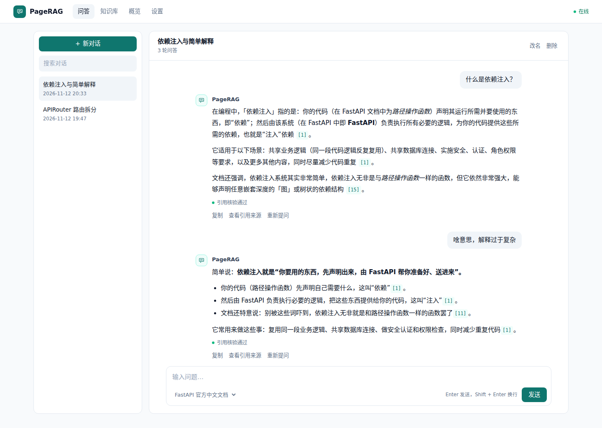
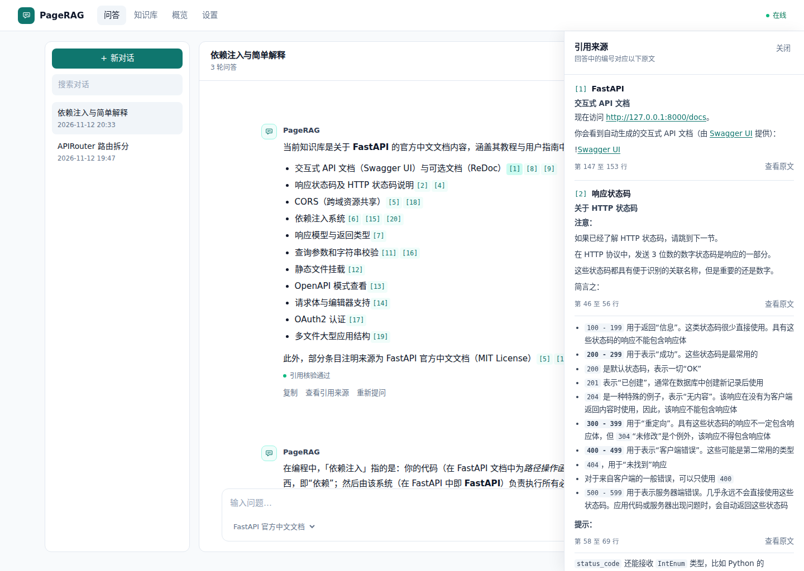
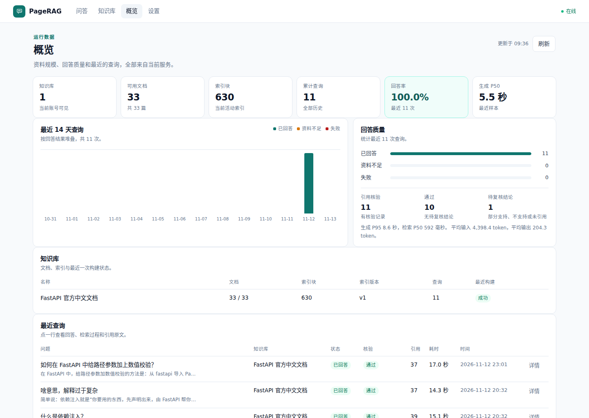
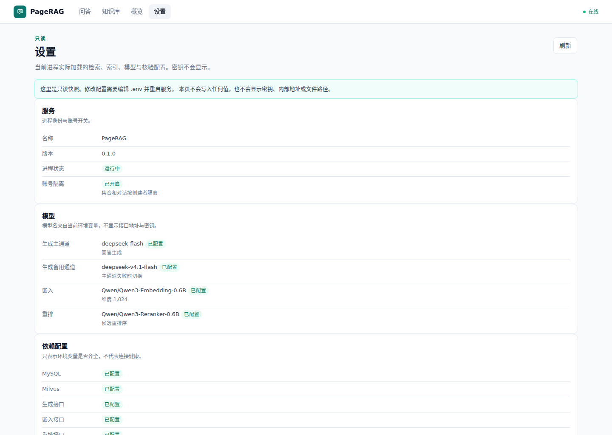
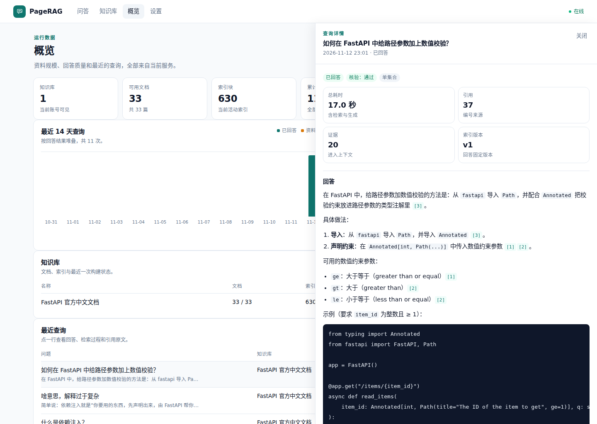
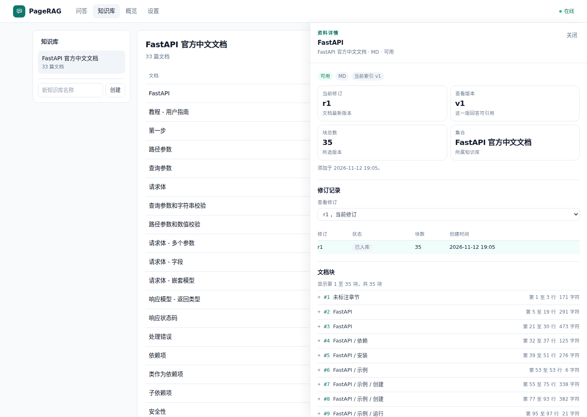
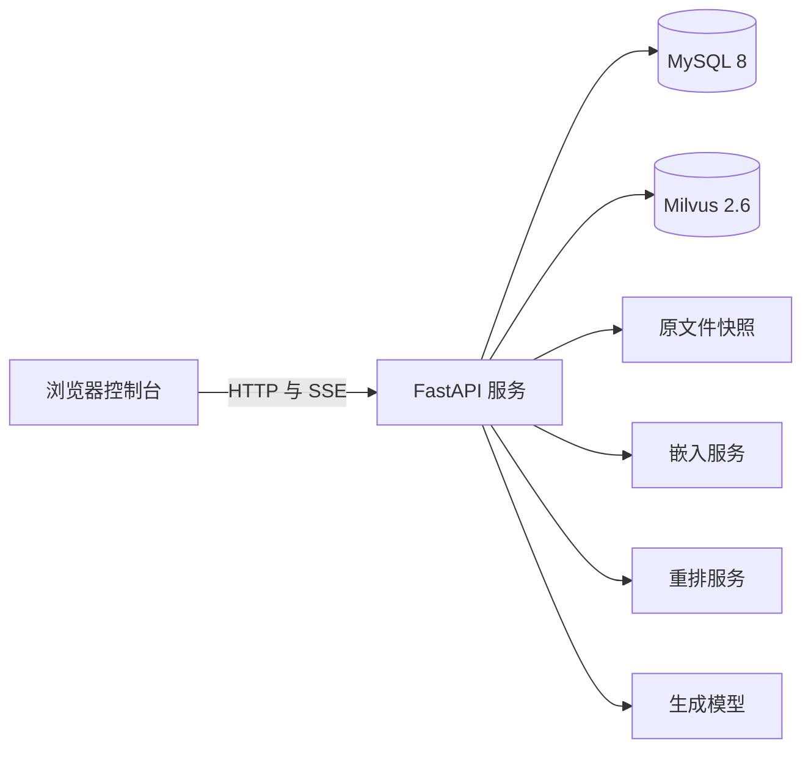
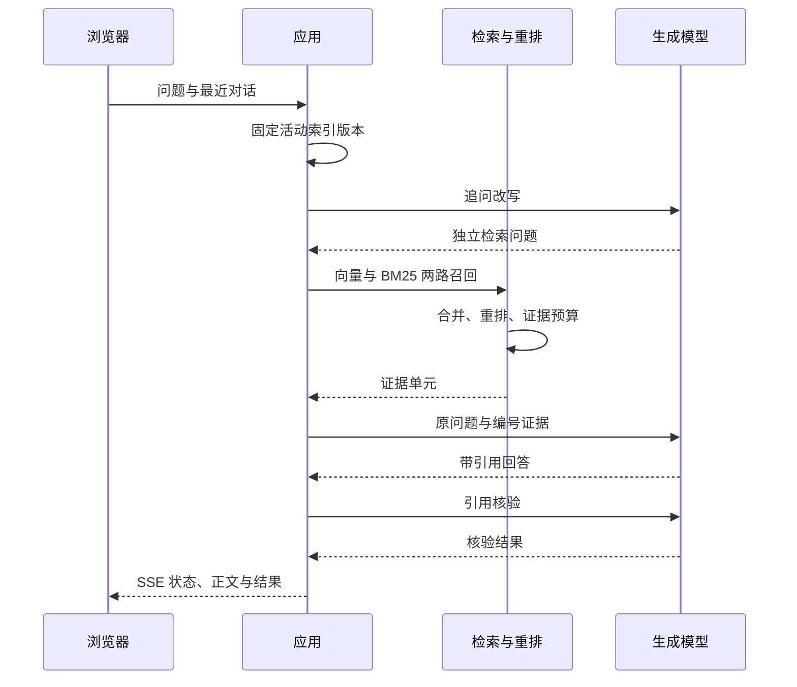

<p align="center">
  
</p>

<h1 align="center">PageRAG</h1>

<p align="center">在自己电脑上问文档，编号能点回原文</p>

<p align="center">
  <a href="https://github.com/POZLOIZ/PageRAG/actions/workflows/ci.yml"></a>
  
  
  
  
</p>

PageRAG 是一个文档问答工具。把 Markdown、TXT 或文本型 PDF 放进知识库，就能对着这些文件提问。回答里的编号指向原文，点开能看到它来自哪一章、哪一行或 PDF 的哪一页。

导入过的文件会留下修订记录，查询用到的证据也存着，所以文档改了以后，旧回答还能按当时的内容核对。界面在浏览器里，顶部切换问答、知识库、概览和设置。

比如问 FastAPI 的依赖注入是怎么回事，回答里提到子依赖的地方会带一个编号。点开它，右边就是那一段的原文和行号，不用自己翻文档。



## 目录

- [快速开始](#快速开始)
- [功能](#功能)
- [使用](#使用)
- [工作方式](#工作方式)
- [文件与数据](#文件与数据)
- [配置](#配置)
- [项目结构](#项目结构)
- [测试](#测试)
- [常见问题](#常见问题)
- [参与贡献](#参与贡献)
- [致谢](#致谢)

## 快速开始

### 准备服务

PageRAG 需要以下服务：

- Python 3.12 和 [uv](https://docs.astral.sh/uv/)
- MySQL 8
- Milvus 2.6
- 一个兼容 OpenAI `/v1/chat/completions` 的生成模型接口
- 一个提供 `/v1/embeddings` 的嵌入服务
- 一个提供 `/rerank` 的重排服务。默认策略 `hybrid-rerank` 需要它，`dense` 和 `hybrid-rrf` 可以不用

### 建库与配置

下面的用户名和密码只是示例，需要换成自己的值。

```sql
CREATE DATABASE pagerag CHARACTER SET utf8mb4 COLLATE utf8mb4_0900_ai_ci;
CREATE USER 'pagerag'@'%' IDENTIFIED BY 'change-me';
GRANT ALL PRIVILEGES ON pagerag.* TO 'pagerag'@'%';
```

Milvus 默认连接 `http://127.0.0.1:19530`。没有开启认证时 token 留空。嵌入服务和重排服务的请求格式写在 `.env.example` 的注释里。

```bash
cp .env.example .env
# 编辑 .env，填入数据库、Milvus、模型和生成接口
```

### 启动

```bash
uv sync --locked
uv run pagerag-check
uv run pagerag init-db
uv run pagerag serve --host 127.0.0.1 --port 8000
```

`pagerag-check` 会检查虚拟环境、依赖和健康接口。加上 `--services` 还会连接 MySQL 并写入一张临时表，再读取 Milvus 的版本号，方便在第一次启动前排掉环境问题。

打开 `http://127.0.0.1:8000/` 进入控制台。`http://127.0.0.1:8000/docs` 是完整的接口文档，健康检查是 `GET /healthz`。

`init-db` 只创建缺失的表，重复执行不会改动已有表。升级已有数据库时，需要按新版表结构补列。

### 导入示例知识库

仓库自带一套从 FastAPI 官方仓库抽取的中文文档，可以直接拿它试问答。

```bash
uv run python scripts/seed_demo_kb.py \
  --base-url http://127.0.0.1:8000 \
  --collection 'FastAPI 官方中文文档'
```

脚本会调用正在运行的服务，建知识库、上传 33 篇文档，再重建索引。重复执行会跳过已经存在的同名文档。这套语料正文约 18 万字，带 58 条可回答问题，问题清单在 `fixtures/demo/fastapi-docs/questions.jsonl`。导入后会切成约 630 个块。

需要重新生成示例文档时运行：

```bash
uv run python scripts/fetch_fastapi_docs.py
```

## 功能

### 连续追问

问答页选好知识库就能直接提问，回答边生成边显示。对话保存在 MySQL 里，刷新页面或换浏览器再打开还在，左侧能搜索、改名和删除。接着追问时，会先把你这句话补成完整的问题去检索，回答还是按你原来的问法来写。

### 引用能翻回原文

点回答里的编号，右侧会打开来源面板，显示这段话来自哪篇文档、哪一章、第几行或第几页，前后段落也一起列出来。回答生成后，系统会检查每条结论有没有标出引用，标出的引用是否真的支持这句话。发现问题时让模型改一次，再重新核验。

### 文档更新与索引重建

同一篇文档可以上传新版本。点更新并选好文件后会自动重新处理，新内容单独切块，发布新的索引版本，旧版本切出来的块不会被覆盖。旧回答的来源仍然指向当时的修订，点开还能核对。处理中断后，再点一次重新处理会从已完成的批次继续。

### 跨知识库问答

知识库下拉框里有全部知识库这个选项。选中它，就能一次问所有库：每个库各找一遍，再把结果放在一起排序。跨库问答不写进左侧对话，刷新页面就没了。

### 检索与失败处理

默认会查两遍：一遍按语义找相近段落，一遍用 BM25 按关键词和术语做词面匹配。两路结果合并去重后交给重排模型，命中的段落再连同前后文拼成上下文。同一篇文档在第一轮里最多占三个位置，剩下的名额按排序补上。

两条生成通道都配上时，一条超时、限流、连不上或返回 5xx 会切到另一条。只配一条的话，重试之后直接报错。两路检索有一路失败，另一路的结果仍然能用。

## 使用

### 第一次问答

1. 打开 `http://127.0.0.1:8000/`。
2. 在知识库页新建一个知识库，上传 Markdown、TXT 或文本型 PDF，等待后台建完索引。
3. 回到问答页选择这个知识库，输入问题。
4. 点击回答里的编号，打开右侧来源面板核对原文。



### 更新一篇文档

在知识库页找到这篇文档，点右侧的更新，选新版本文件。上传后会自动开始处理，页面显示构建进度。新问题用新内容回答，旧回答的引用仍然指向旧修订。

### 查看一次回答是怎么产生的

在概览页点开一条最近查询，能看到候选池、进入上下文的证据、引用原文和每步耗时。文档详情里则是修订次数、索引进度和切分结果。

| 概览 | 设置 |
| --- | --- |
|  |  |

| 查询详情 | 资料详情 |
| --- | --- |
|  |  |

## 工作方式



MySQL 存知识库和文档。修订、切出来的块、索引版本、查询记录、引用和对话也在这里。Milvus 只放向量，每个索引版本一套。原文件和运行数据在 `PAGERAG_DATA_DIR` 下，数据库里只记路径和哈希。

### 导入链路

上传的文件先存一份快照，再记下这次修订。解析器按标题、段落、代码围栏和表格边界切块，合并段落时以 500 字符为目标，单个段落超过 3000 字符才按句末切开。每个块都记下字符区间和从 1 开始的行号。PDF 还会记页码，另外算一个内容哈希。

写入按批进行。每批的块先写进数据库，再编码成向量写进 Milvus，最后标记这一批已经写完。进程中途退出，最多重做最后一批。全部文档完成后发布新的索引版本，之后的查询才会用新版本。

### 提问链路

一次查询开始时固定当时的索引版本，构建中的新版本不会影响这次回答。如果当前对话有历史，会先把追问改写成一句适合检索的话，检索和重排都用它，生成回答时再用你原来的问题。

两路检索合并后重排，命中的段落连同前后段落一起进入上下文，总量按 token 预算截断。生成完成后逐条核对结论的引用，发现问题就让模型改一次，最后通过 SSE 把状态、正文和结果推回浏览器。



## 文件与数据

| 格式 | 处理方式 |
| --- | --- |
| `.md` / `.markdown` | 按标题、段落、围栏和表格边界切块，保留章节路径与表头 |
| `.txt` | 按段落和结构边界切块 |
| `.pdf` | 逐页提取文本后切块，不解析表格，也不做 OCR |

单个文件最大 50 MB。扫描版 PDF、图片型表格和 `.docx` 暂不支持，需要先转成文本或 Markdown。

删除文档以后，它不会再被检索到。历史回答里的来源记录还留着，只是点开看不到正文。改分块参数、嵌入模型或向量维度以后要重新处理。

## 配置

常用环境变量如下。`.env.example` 只是常用配置示例，全部可配置项和默认值见 `src/pagerag/settings.py`。

| 变量 | 作用 |
| --- | --- |
| `PAGERAG_DATABASE_URL` | MySQL 8 连接 |
| `PAGERAG_MILVUS_URI` / `PAGERAG_MILVUS_TOKEN` | Milvus 地址与认证 |
| `PAGERAG_LLM_BASE_URL` / `PAGERAG_LLM_MODEL` / `PAGERAG_LLM_API_KEY` | 生成模型 |
| `PAGERAG_LLM_PRIMARY_BASE_URL` / `PAGERAG_LLM_PRIMARY_MODEL` / `PAGERAG_LLM_PRIMARY_API_KEY` | 可选的另一条生成通道，配上以后自动切换 |
| `PAGERAG_EMBEDDING_BASE_URL` / `PAGERAG_EMBEDDING_MODEL` / `PAGERAG_EMBEDDING_DIMENSIONS` | 嵌入服务、模型与向量维度 |
| `PAGERAG_RERANK_URL` / `PAGERAG_RERANK_MODEL` | 重排服务，默认策略必填 |
| `PAGERAG_RETRIEVAL_STRATEGY` | `hybrid-rerank`、`dense` 或 `hybrid-rrf` |
| `PAGERAG_DATA_DIR` | 原文件快照与运行数据 |
| `PAGERAG_CHUNK_CHARS` / `PAGERAG_CHUNK_MAX_CHARS` | 分块软目标与硬上限 |

分块参数、嵌入模型或维度、解析器版本、切块器版本和关键词分析器都算索引的一部分。任何一项变了都要重新处理。

## 项目结构

| 路径 | 内容 |
| --- | --- |
| `src/pagerag/` | FastAPI 服务、导入、检索、生成、核验和控制台 |
| `tests/` | 离线测试 |
| `fixtures/demo/fastapi-docs/` | FastAPI 官方中文文档示例语料 |
| `scripts/fetch_fastapi_docs.py` | 重新抓取示例语料 |
| `scripts/seed_demo_kb.py` | 通过 HTTP 接口导入示例知识库 |
| `assets/screenshots/` | README 使用的运行截图 |
| `.github/workflows/ci.yml` | 推送后自动执行 ruff 与 pytest |

后端按链路拆在 `ingest.py`、`retrieval.py`、`answering.py` 和 `verification.py` 里，浏览器控制台在 `static/` 下，没有前端构建步骤。

## 测试

```bash
uv run pytest -q
uv run ruff check src tests
```

测试全部离线运行，不需要 MySQL、Milvus 或模型服务，也不读取本机 `.env`。覆盖分块与原文定位、检索融合、证据组装和引用核验，也有导入中断恢复、对话和状态接口的用例。

GitHub Actions 在 `main` 分支的推送和拉取请求上执行 ruff 与 pytest，工作流见 `.github/workflows/ci.yml`。

## 常见问题

**支持哪些文件？**

Markdown、TXT 和带文本层的 PDF。扫描版 PDF、图片型表格和 `.docx` 需要先转成文本或 Markdown。

**一定要部署重排服务吗？**

默认策略 `hybrid-rerank` 需要。把 `PAGERAG_RETRIEVAL_STRATEGY` 改成 `dense` 或 `hybrid-rrf` 后可以不配置重排服务。

**文档更新后，旧回答还能核对吗？**

可以。每次修订单独切块，旧回答保存了当时的证据和原文位置。新修订处理完以后，查询才会用新内容。

**资料会被发送到哪里？**

原文件快照、索引元数据和查询记录留在本机。正文会发送给你配置的嵌入、重排和生成服务。如果这些服务也部署在本机，资料不会离开这台机器。

**可以一次问多个知识库吗？**

可以。在问答页选择全部知识库，每个库各找一遍，再合并排序。跨库问答只留在当前页面，不写入左侧对话。

## 参与贡献

问题和改进建议可以直接开 issue。提交代码前请运行：

```bash
uv run pytest -q
uv run ruff check src tests
```

改动尽量围绕一个主题，并附上复现步骤或测试。涉及检索、分块或证据组装的行为变化，请在说明里写清楚预期影响。

## 致谢

示例语料来自 [FastAPI 官方中文文档](https://github.com/fastapi/fastapi)，上游提交 `993400812ce9f21a2a424e8366984b49b11f25f5`，按 MIT 许可使用。许可全文在 `fixtures/demo/fastapi-docs/LICENSE`。
